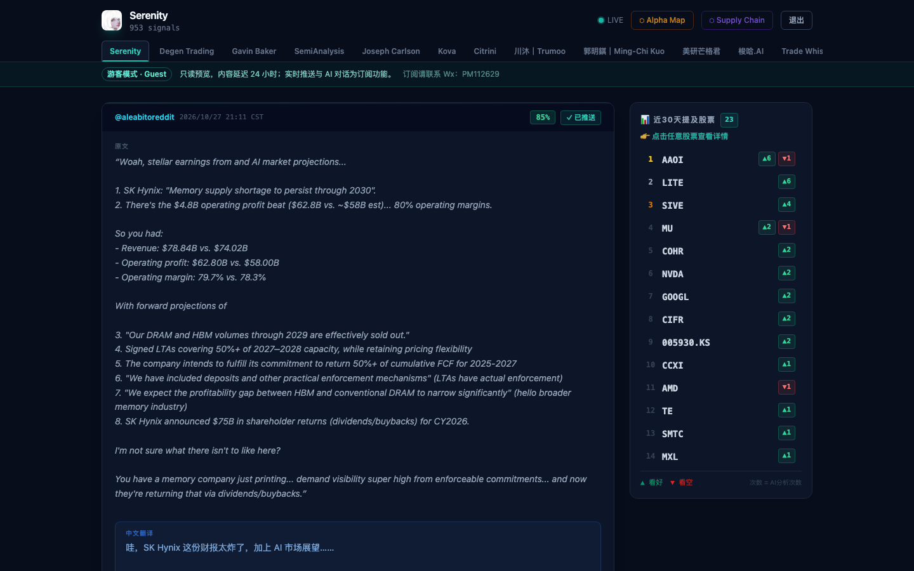
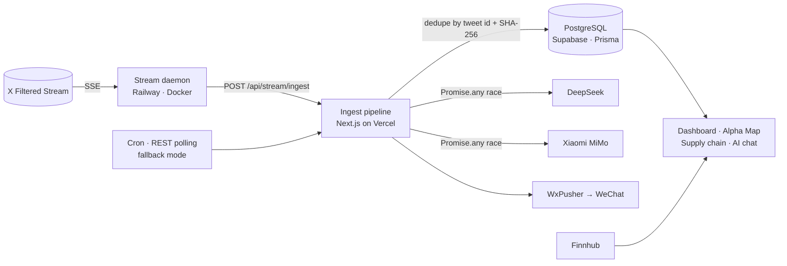
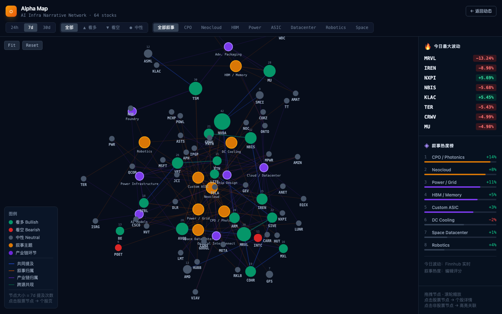
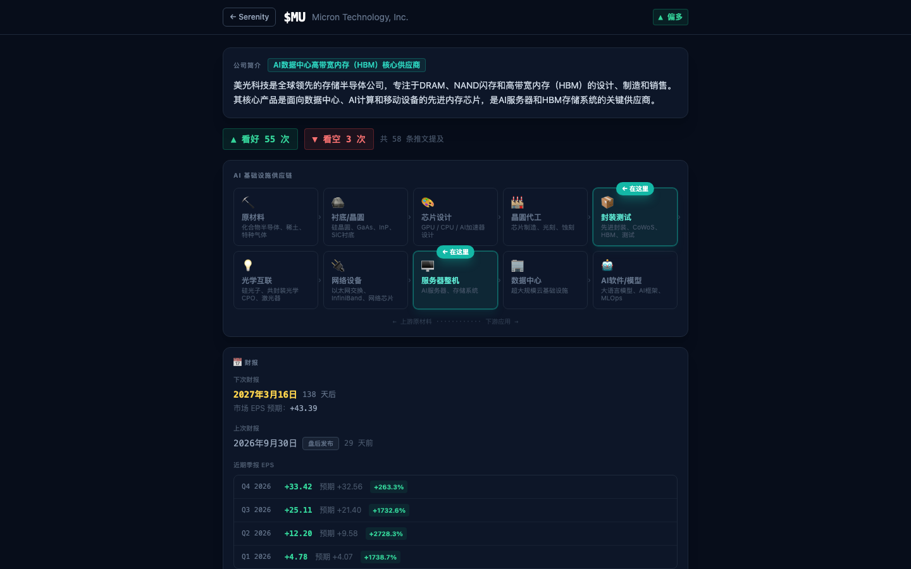
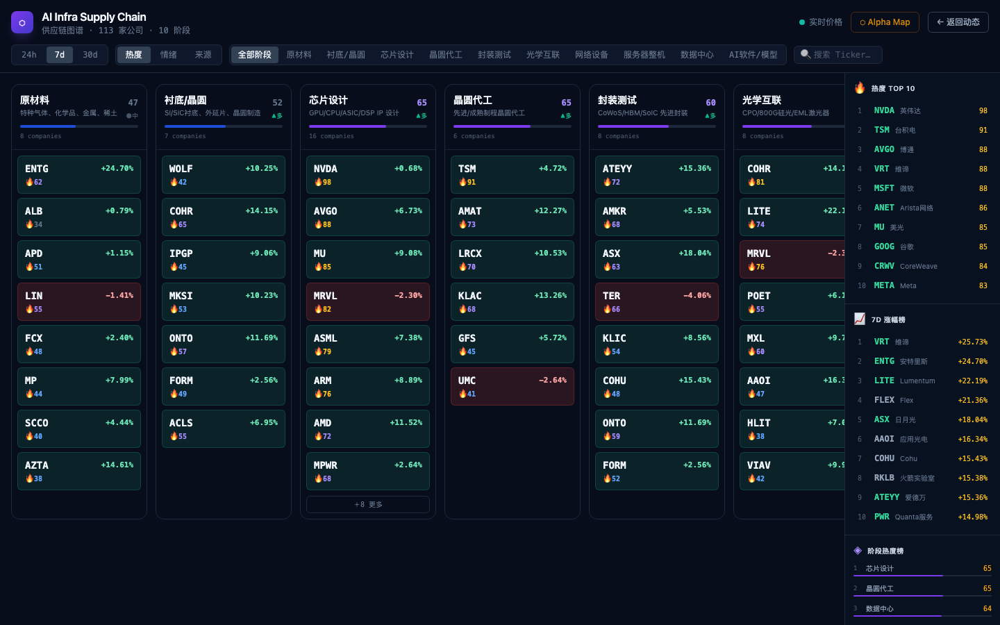
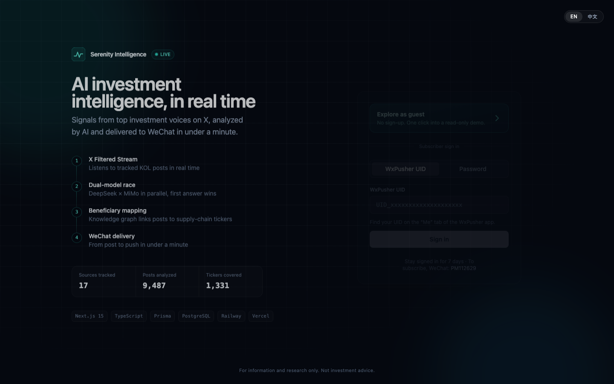

# Serenity Intelligence

[](https://github.com/mengchen-atx/Stocks_Serenity/actions/workflows/ci.yml)


**Real-time AI investment intelligence.** Serenity follows 17 investment and AI-infrastructure voices on X. It analyzes each post with LLMs: translation, summary, and bullish/bearish ticker extraction. Results go to a web dashboard and to subscribers on WeChat, typically within a minute of the original post.

It is a live product with paying users. I designed, built, and operate it end to end.

**🔗 Live: [alphaline.fit](https://www.alphaline.fit)** → click **“Explore as guest”** for a one-click, read-only demo (no sign-up).



## At a glance

| | |
|---|---|
| Sources tracked | 17 X accounts, one channel each |
| Posts ingested and analyzed | 9,000+ since May 2026 (live counter on the login page) |
| Tickers covered | 1,300+ |
| Customers | 100+ paying subscribers to date |
| LLM robustness suite | 152 / 152 cases passed across two rounds ([reports](docs/benchmarks/)) |

## Architecture



1. **Ingest.** A long-running daemon holds one connection to the X Filtered Stream and forwards each post to an authenticated ingest endpoint. A cron-driven REST poller with per-author adaptive intervals is kept as a fallback mode.
2. **Analyze.** Two LLM providers race in parallel. The first valid, schema-conforming answer wins.
3. **Store and fan out.** The analysis and ticker mentions are saved. Each channel's subscribers get a formatted WeChat message.
4. **Read.** A server-rendered dashboard shows the feed, a 30-day ticker leaderboard, a D3 force-directed "Alpha Map", a supply-chain view, and a streaming research chat.

## Engineering highlights

**Resilient streaming ingestion** ([`scripts/stream-daemon.ts`](scripts/stream-daemon.ts))
- Heartbeat watchdog: X sends a keep-alive every 20 s, and the daemon reconnects if nothing arrives for 40 s.
- Exponential backoff from 1 s up to 5 min. Stream rules re-sync from the database every 5 min.
- Fatal account errors, such as depleted API credits, stop the retry loop and alert the admin on WeChat instead of retrying forever.

**Reliable structured output from LLMs** ([`lib/ai.ts`](lib/ai.ts), [`lib/ai-normalize.ts`](lib/ai-normalize.ts))
- DeepSeek and Xiaomi MiMo run in parallel through `Promise.any`, so one provider's outage, quota, or malformed output doesn't block delivery.
- Model output passes through several layers: a state-machine sanitizer escapes raw newlines and curly or full-width quotes inside JSON strings, then `jsonrepair`, then Zod validation and normalization (confidence scaling, ticker dedupe).
- If every model fails, subscribers still get the original post rather than nothing.

**Deduplication and push bookkeeping** ([`lib/pipeline.ts`](lib/pipeline.ts))
- Posts are deduplicated by X id and by a SHA-256 hash of author + content, which catches re-posts and backfill overlap.
- Every push is recorded per (post, channel, payload hash), so retries and backfills skip messages that were already sent.

**Auth, access control, and abuse protection**
- Stateless sessions are HMAC-SHA256 signed and compared in constant time ([`lib/session-token.ts`](lib/session-token.ts)).
- Access is granted per channel with expiry dates, and synced from the WeChat subscription provider.
- Guest mode for reviewers: read-only, all channels unlocked, content delayed by 24 h, and no paid LLM calls. The delay cutoff is floored to the hour so guests share one cache entry.
- A sliding-window rate limiter on dashboard routes blocks scrapers ([`middleware.ts`](middleware.ts)).

**Frontend**
- Next.js 15 App Router with React Server Components, and `unstable_cache` for the expensive aggregate queries.
- D3 force-directed graph with zoom and drag, a sticky sidebar layout, and a bilingual (EN / 中文) login page.

## Screenshots

| Alpha Map: ticker and narrative network | Ticker page: supply-chain position and earnings |
|---|---|
|  |  |
| **Supply-chain heat map** | **Login with guest mode** |
|  |  |

## Tech stack

**App:** Next.js 15, React 19, TypeScript, Tailwind CSS, D3
**Data:** PostgreSQL (Supabase, pgbouncer), Prisma
**AI:** DeepSeek and Xiaomi MiMo (OpenAI-compatible APIs), Zod, jsonrepair. Anthropic and Gemini adapters are also included.
**Infra:** Vercel (web and API), Railway (stream daemon, Docker), GitHub Actions (CI)
**Integrations:** X API v2, WxPusher (WeChat), Finnhub

## Project structure

```
app/                 Next.js routes: dashboard, auth, guest demo, API handlers
  api/stream/ingest  Authenticated endpoint the stream daemon posts to
  api/cron           Scheduled polling, retries, and maintenance
lib/                 Domain logic
  pipeline.ts        Ingest → dedupe → analyze → store → push
  ai.ts              Provider routing and the parallel model race
  ai-normalize.ts    JSON extraction, repair, and validation of model output
  channels.ts        Per-channel access control
  session-token.ts   Signed session tokens
prisma/              Schema and migrations
scripts/             Stream daemon and operational scripts (see scripts/README.md)
tests/               Vitest unit tests
docs/benchmarks/     LLM robustness test reports
```

## Running locally

```bash
npm install --legacy-peer-deps
cp .env.example .env.local        # fill in DATABASE_URL, OPENAI_API_KEY, TWITTER_BEARER_TOKEN, ...
npm run prisma:migrate
npm run dev                       # http://localhost:3000

# Optional: run the real-time ingestion daemon
npx tsx --env-file=.env.local scripts/stream-daemon.ts
```

## Quality checks

```bash
npm run lint
npm run typecheck
npm test                 # Vitest unit tests
npm run test:coverage
```

CI runs all of the above on every push and pull request.

## Disclaimer

For information and research only. Not investment advice.

---

[中文说明](README.zh-CN.md)
